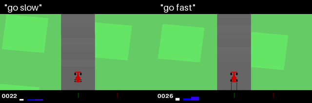

# GymDriveVLA

A small vision-language-action (VLA) driving project for Gymnasium's
`CarRacing-v3`. Given a camera frame and a short instruction, the model
predicts steering, throttle, and brake controls.

The demo below shows the same trained policy driving an unseen track with two
different instructions:



## How it works

1. A scripted expert drives the track centerline and targets a speed based on
   the instruction (`go slow` or `go fast`).
2. The collector saves observations and expert actions. It occasionally adds
   steering noise while driving, but retains the clean expert action as the
   training label.
3. A pretrained ResNet-18 encodes each image. A frozen MiniLM sentence encoder
   embeds the instruction. An MLP combines both representations and predicts
   steering, gas, and brake.
4. Evaluation runs the policy on new track seeds. During the initial zoom-in
   frames, the expert drives so the model starts from a state similar to its
   training data.

The example GIF is included. The demonstration dataset and trained checkpoint
are kept out of this repository, so collect demonstrations and train a
checkpoint before running evaluation or generating a new GIF.

## Requirements

- Python 3.11
- Gymnasium with Box2D, PyTorch, Torchvision, Transformers, NumPy, and Pillow

Create an environment and install the dependencies:

```bash
python3.11 -m venv .venv
source .venv/bin/activate
python -m pip install --upgrade pip
python -m pip install "gymnasium[box2d]" torch torchvision transformers numpy pillow
```

On macOS, install SWIG if the Box2D dependency needs it:

```bash
brew install swig
```

The first run may download the pretrained ResNet-18 weights and MiniLM model.
The scripts use Apple Metal (MPS) when available, otherwise they run on CPU.

## Train and run

Collect demonstrations (50 episodes per instruction by default) and train a
checkpoint:

```bash
python collect_demos.py --episodes 50 --out data
python train.py --data data --epochs 5
```

Training writes the best validation checkpoint to
`checkpoints/drive_vla.pt`.

Watch the trained model drive one unseen track with the `go fast` instruction:

```bash
python evaluate.py --instruction "go fast" --episodes 1 --render
```

Evaluate both trained instructions over 20 unseen tracks:

```bash
python evaluate.py --episodes 20
```

Generate a new side-by-side GIF:

```bash
python record_gif.py --out gymdrivevla.gif
```

The GIF recorder defaults to seed `1000`, 450 model-controlled steps per
instruction, and keeps every third rendered frame. To record one instruction:

```bash
python record_gif.py --instructions "go slow" --out go_slow.gif
```

## Collect and train

To collect 50 episodes for each instruction and save them under `data/`:

```bash
python collect_demos.py --episodes 50 --out data
```

To visually inspect an episode while collecting:

```bash
python collect_demos.py --episodes 1 --render
```

Train for five epochs using the included demonstrations:

```bash
python train.py --data data --epochs 5
```

Training selects the validation split by holding out entire track seeds and
saves the best validation checkpoint to
`checkpoints/drive_vla.pt`. Useful options include `--batch-size`, `--lr`,
`--val-frac`, and `--out`; run `python train.py --help` for defaults and
details.

To preserve the included dataset when collecting new demonstrations, choose a
different output directory and pass it to training:

```bash
python collect_demos.py --episodes 50 --out data_new
python train.py --data data_new --epochs 5
```

## Project files

| Path | Description |
| --- | --- |
| `collect_demos.py` | Scripted expert and demonstration collector |
| `train.py` | Dataset loading, model definition, and training |
| `evaluate.py` | Closed-loop evaluation and optional live rendering |
| `record_gif.py` | Side-by-side GIF generation |
| `data/` | Local demonstration episodes (`.npz`) and their `index.csv` (not tracked) |
| `checkpoints/drive_vla.pt` | Locally trained model checkpoint (not tracked) |
| `gymdrivevla.gif` | Example rollout shown above |
